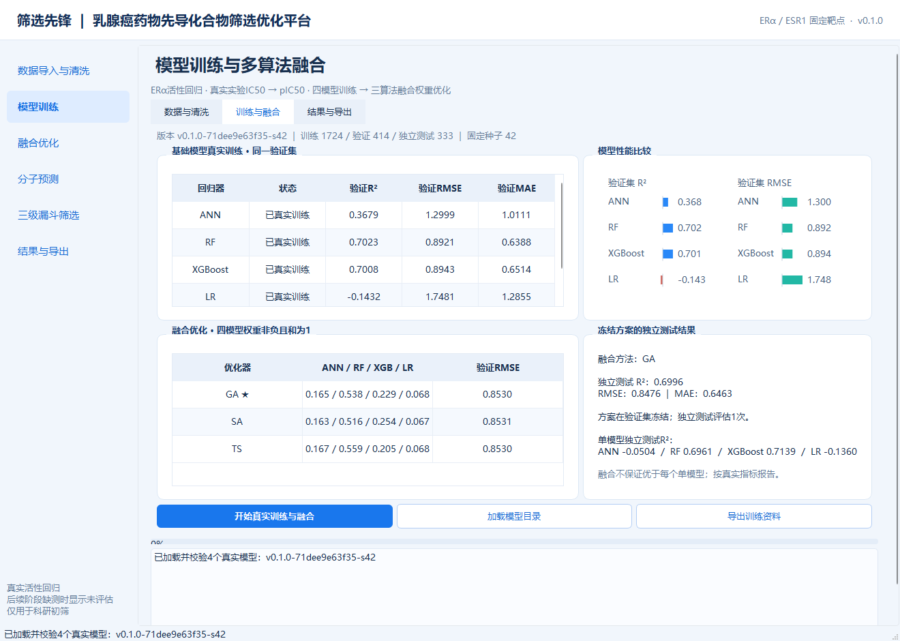
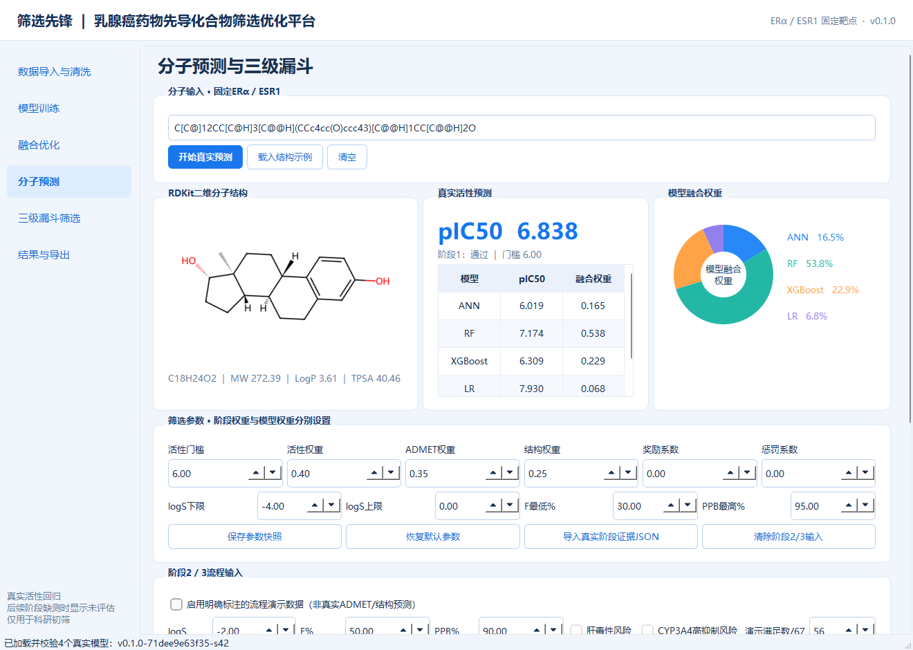
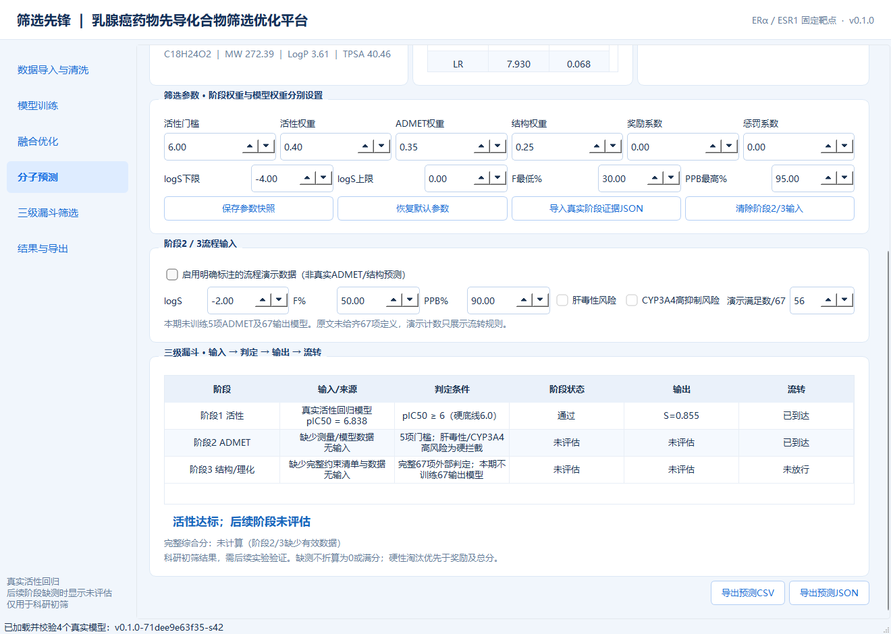

# 实际训练和验证记录

记录日期：2026-10-28，目标环境Windows 11 x64、Python 3.12.10。模型版本 `v0.1.0-71dee9e63f35-s42`。机器可读信息见 `validation_summary.json`，详细日志/固定索引/搜索历史保存在本地models与reports目录。

## 数据与独立评估

ChEMBL人类ESR1直接结合记录7343条；清洗并聚合后2471个化合物、791个结构组。固定种子42，训练1724、验证414、独立测试333。结构组跨集合无交集，集间Morgan2048最高相似度低于0.85的检查已通过。原始记录量不能等同于独立化合物量。

验证集选择GA融合，模型权重ANN/RF/XGBoost/LR为 0.164536 / 0.538365 / 0.228833 / 0.068265。测试集只在方案冻结后评估；后续验证根据封存预测文件核对指标，没有用测试标签调参。

| 独立测试模型 | R² | RMSE | MAE |
|---|---:|---:|---:|
| ANN | -0.0504 | 1.5850 | 1.2173 |
| RF | 0.6961 | 0.8526 | 0.6539 |
| XGBoost | 0.7139 | 0.8273 | 0.6485 |
| LR | -0.1360 | 1.6484 | 1.2713 |
| ensemble | 0.6996 | 0.8476 | 0.6463 |

融合没有超过XGBoost的测试R²；ANN和LR本次泛化较弱，负R²保留。不得将示意图分数作为实测或承诺，也不能将此测试结果等同于临床、完整ADMET或全部67项科研验证。

## 已执行检查

- 自动测试：32项，失败0、错误0、跳过0。包括单位/精确标签、坏分子、重复冲突、特征一致性、分组隔离、三种优化复现、权重非法值、硬淘汰、缺测/演示、动态参数、真实模型加载、桌面预测/导出和后台失败恢复。
- 源码Windows原生Qt窗口检查：passed，Qt平台为windows。实际打开窗口、加载模型、触发预测按钮、绘制结构、检查默认缺测、演示风险淘汰和无效SMILES。
- Windows便携EXE原生窗口检查：passed。
- Windows便携EXE官方数据下载及清洗：passed；与源码版清洗CSV的SHA256一致。构建依赖限定为项目虚拟环境、Python和Windows目录，外来工具DLL数量为0。
- Logo资源与显示：True；PNG、SVG、ICO均随包，页眉、窗口标题栏和EXE图标使用同一Logo。
- 独立源码包检查：passed。

## 实际运行界面

以下来自真实运行，分子输入和指标均由程序计算。

